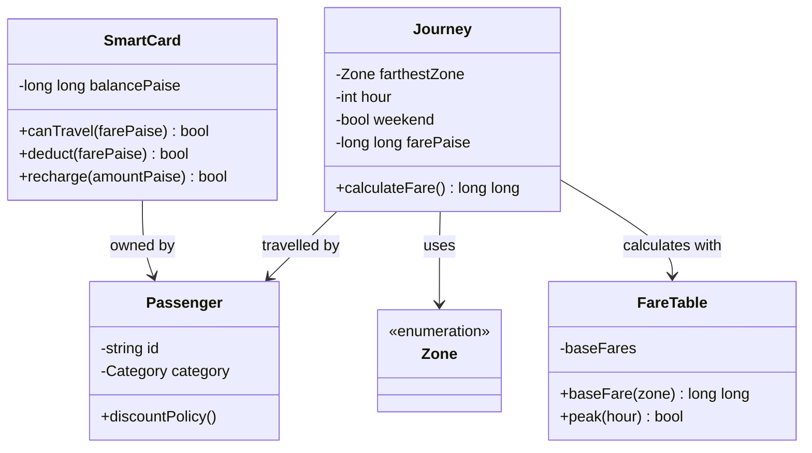

# DSA01 Assignment 1 — working draft

**Student:** Madhurantakam Kavya  
**Register number:** [192472370]  
**Repository:** [https://github.com/madhurantakamkavya12/DSA0104-192472370-Assignment-1]  
**Compiler:** g++ 16.2.0 (MSYS2 UCRT64)  
**Compile command:** `g++ -std=c++17 -Wall -Wextra -pedantic file.cpp -o program`

> Use this as a working draft, not as a substitute for your own execution evidence. In particular, fill in the compiler/version, record your own output, attach screenshots, and make the required progressive commits. I could not execute the C++ files in this workspace because no C++ compiler is installed here.

## Design assumptions

- The fare is based on the farthest zone reached: Inner Rs 10, Middle Rs 20, Outer Rs 30.
- The 20% peak surcharge applies on the half-open intervals 08:00–09:59 and 17:00–19:59. Thus exactly 08:00 and 17:00 are peak; exactly 10:00 and 20:00 are off-peak.
- A trip is allowed only when the resulting balance is **at least** Rs 50.
- The original brief says students and senior citizens receive a concession but gives no amount or stacking rule. This draft does not invent a concession rate; that rule must be confirmed with the instructor or stated as an explicit assumption before implementing it.
- In Task 12, the 10% weekend discount replaces the peak surcharge; they do not stack. Monthly pass covers the two selected zones with zero fare. The exact monthly validity dates and whether the Rs 50 floor applies to pass journeys are unspecified; this design treats a covered trip as free and does not debit the card.

## Task 1 — Objects and rules (4)

A `SmartCard` owns a balance and provides `canTravel`, `deduct`, and `recharge`; hiding the balance prevents unrelated code from making it negative or bypassing the Rs 50 minimum. A `Passenger` holds an identity and category (ordinary, student, senior), which is useful because concessions depend on the rider. A `Journey` records origin/destination or farthest zone, hour, date/weekend flag, and the computed fare; it represents one transaction and its audit trail. `Zone` is a finite set of named network regions. `FareTable` owns the base fares and rule parameters so a fare revision has one source of truth.

Procedurally, global balance/fare arrays and free functions can calculate and debit a journey. In the OO design, state and the operations that protect its invariants live together. Encapsulation is the private card balance; abstraction is exposing `deduct(fare)` instead of requiring callers to manipulate paise. Inheritance may model `StudentPassenger` and `SeniorPassenger` from a common `Passenger`, but a category/strategy is often simpler if only the discount policy varies. Polymorphism can provide a virtual `discountFor(Journey)` strategy, allowing concession rules to vary without branching throughout fare calculation.

Rules: valid zone and hour; fare nonnegative; fare calculated in exact paise; fare uses the farthest zone; peak boundaries are inclusive at 8/17 and exclusive at 10/20; card starts/recharges nonnegative; a debit occurs only if `balance - fare >= 5000`; denial leaves balance unchanged. Per journey, the fare decision and debit are O(1), and state per card is O(1). Procedural and OO forms have the same asymptotic time and per-card storage. OO centralizes invariants and usually localizes a rule change; procedural code can be equally fast but requires disciplined access to shared state and may need edits in multiple call sites.

**Alternative and complexity:** A procedural solution uses `long long balancePaise`, `baseFare(zone)`, `isPeak(hour)`, `computeFare(...)`, and `canTravel(balance,fare)` functions. Complexity remains O(1) per journey and O(1) memory per card in both versions. Changing a minimum-balance rule is one constant change if centralized in either style; if it was duplicated, each duplicate has to be found and changed. Encapsulation reduces the chance of missing a debit path.

Conceptual UML for the OO design:



## Task 2 — Tokens and constants (3)

Example tokens in `FareSystem.h`: keyword `constexpr`, identifier `MIN_REMAINING_PAISE`, literal constant `5000`, operator `>=`, punctuator `{` or `;`. `#define` performs textual substitution without type or scope; `const` makes an object immutable; `constexpr` additionally requires compile-time evaluation when possible. Use `constexpr` for fixed fares, percentages and thresholds so type checking and compile-time evaluation apply. `enum class Zone` scopes zone names and disallows accidental implicit conversion to integers; a plain `enum` permits more implicit conversions and may leak enumerators into surrounding scope. Identifiers use descriptive lower camel case for functions/variables and uppercase snake case for constants; they cannot start with a digit, contain spaces, or be a keyword.

**Alternative and complexity:** Replacing typed constants/enums with macros removes type checking and scope and can cause precedence surprises (for example a macro expression lacking parentheses). A macro itself occupies no storage; a `constexpr` object usually needs no runtime storage when optimized/constant-folded. Runtime complexity is unchanged (O(1) lookup/computation); an array of fares uses O(z) static storage for z zones.

## Task 3 — Types and compatibility (4)

| Value | Type | Reason |
|---|---|---|
| Money, fare, balance, totals | `long long` paise | Exact integer arithmetic; large totals |
| Hour / zone index / percentage | `int` | Small bounded whole numbers |
| Peak/weekend/allowed | `bool` | Two-state condition |
| Passenger initial/name character | `char` only for a single character; `std::string` for names | Correct semantic size |
| Journey count | `long long` | Network scale and future growth |
| Fractional reporting only | `double` | Presentation/measurement, not authoritative money |

Record actual `sizeof` on your compiler. Typical desktop implementations report `sizeof(bool)=1`, `sizeof(char)=1`, `sizeof(int)=4`, `sizeof(long long)=8`, `sizeof(double)=8`; the C++ standard guarantees minimum ranges, not these exact sizes. `<climits>` provides `INT_MAX` (at least 32767; commonly 2,147,483,647) and `LLONG_MAX` (at least 9,223,372,036,854,775,807). At 3,000,000 trips × Rs 30 peak fare = Rs 108,000,000 (10,800,000,000 paise), which exceeds a common 32-bit signed `int` maximum in paise; `long long` is appropriate.

Observed with g++ 16.2.0: `sizeof(bool)=1`, `sizeof(char)=1`, `sizeof(int)=4`, `sizeof(long long)=8`, `sizeof(float)=4`, `sizeof(double)=8`; `INT_MAX=2147483647` and `LLONG_MAX=9223372036854775807`. The repeated-double test printed `0.99999999999999989`, while the integer-tenths result was `1`. Save the terminal screenshot in `Task03`. An expression mixing `int` and `double` converts the integer to `double`; a condition used arithmetically can convert `bool` to 0 or 1. `double` stores binary approximations for many decimal fractions. Integer paise exactly represents two-decimal fares and avoids accumulated binary rounding. Addition costs O(1) in either representation, and both `long long`/`double` commonly occupy 8 bytes. Use `Task10/totals.cpp` to measure your own test; in this specific exact whole-Rupee example, double values up to the tested total are exactly representable, so observed difference may be zero. Do not claim a rounding discrepancy unless your experiment demonstrates one. A separate precision demonstration can repeatedly add 0.1 to a double and compare to integer tenths; record actual output.

**Alternative:** Floating-point fare can be rounded using `std::round(rupees * 100)` at a defined boundary, but the canonical amount should still be integer paise. Both operations are O(1); double error depends on magnitudes and operation count and is data-dependent.

## Task 4 — Implicit conversions (4)

**Prediction before running `Task04/predict_conversions.cpp`:**

```text
3 3.5
C 67
1 true
s >= u
```

`a / b` is integer division (both operands are `int`) and produces 3 before conversion to `double`; casting `a` first produces 3.5. `'A' + 2` promotes the character to `int`, adds 2, then converts back to `char` (`C` on ASCII-compatible systems); `ch + 1` promotes `char` back to int and prints 68 (because `C` is 67 in this execution character set, then 1 is added). Integer 5 converts to bool true; default bool output is `1`, and `boolalpha` prints `true`. Comparing `-1` and unsigned 1 converts the signed operand to unsigned; the converted value is large, so `s < u` is false. Signed/unsigned comparisons commonly trigger `-Wsign-compare`. **Observed with g++ 16.2.0:** output was `3 3.5`, `C 68`, `1 true`, `s >= u`; the compiler emitted `-Wsign-compare` for comparing `s` (`int`) with `u` (`unsigned int`). The prediction above said `C 67`; that was my mistake. The actual result is 68 because `ch + 1` promotes `ch` to an integer and then adds 1. Preserve that discrepancy and explain it as a corrected prediction, rather than claiming the prediction matched.

Brace initialization `int x{3.7};` is ill-formed because it narrows; `static_cast<double>(a)` makes the intended conversion explicit. Implicit conversions rarely change asymptotic time or memory. Explicit casts improve readability but do not make a bad conversion safe; range validation is still required. A corrected style uses `static_cast` at intentional boundaries and signed types for values that can be negative.

## Task 5 — Operators and precedence (4)

Peak expression: `(hour >= 8 && hour < 10) || (hour >= 17 && hour < 20)`. Comparisons bind before `&&`, and `&&` binds before `||`; parentheses make the two intervals visible. Peak fare: `base + (base * PEAK_PERCENT) / 100`; multiplication and division precede addition, left-to-right at equal precedence. Concession should be expressed as a named rule and applied once; a discount amount can be `base * discountPercent / 100`. Compound assignment `balance -= fare` subtracts and stores. `x++` yields old value then increments; `++x` increments then yields new value. Avoid `i = i++`, whose historical sequencing behavior is confusing and can be undefined in older language standards. For integers, division truncates toward zero: `-10 / 3 == -3`, remainder keeps dividend sign: `-10 % 3 == -1`.

**Prediction before running `Task05/predict_operators.cpp`:**

```text
11 16
9 6 4
6 4
3 1 -3 -1
18
```

Line 1: `*` before `+`; parentheses force addition first in second expression. Line 2: postfix `x++` yields 5 then x becomes 6; prefix `++y` makes y=4 and yields 4; sum 9. Line 3: ternary chooses x=6; `%` and `*` have equal precedence and associate left-to-right, giving `(6%4)*2=4`. Line 4 uses integer `/` and `%`, including negative truncation. Loop adds 0+3+6+9=18. Increment side effects are on separate operands and well-defined here. The observed g++ 16.2.0 output matched all five predicted lines.

**Alternative:** a 24-entry `bool` table can answer peak checks in O(1), at the cost of 24 bool elements and initialization/maintenance. The expression also uses O(1) space and O(1) time, with at most a few comparisons; it is clearer for just two intervals, while a table can help when schedules are irregular.

## Task 6 — Control structures (4)

Use `switch` for a finite zone-to-base-fare mapping; `if/else` for validity and travel eligibility; use `?:` only for a short value selection, not complex business rules. A counted input collection is naturally processed with `for` or range-based `for`; use `while` for retry-until-valid input. `continue` skips a rejected malformed trip; `break` exits once a fatal condition or end marker is reached. A switch with no matching case and no `default` does nothing, so invalid zones should be rejected with `default` or validation.

**SIMATS-style pseudocode**

```text
ALGORITHM ComputeFare(zone, hour)
BEGIN
    IF hour < 0 OR hour > 23 THEN
        RETURN INVALID
    ENDIF
    SWITCH zone
        CASE INNER: base <- 1000
        CASE MIDDLE: base <- 2000
        CASE OUTER: base <- 3000
        DEFAULT: RETURN INVALID
    ENDSWITCH
    peak <- (hour >= 8 AND hour < 10) OR (hour >= 17 AND hour < 20)
    IF peak THEN fare <- base + (base * 20) DIV 100
    ELSE fare <- base
    ENDIF
    RETURN fare
END
```

`Task06/complete_code.cpp` completes TODO logic through shared `FareSystem.h`. Expected sequence is Rs 10.00 / balance Rs 90.00; Rs 36.00 / balance Rs 54.00; denied / balance Rs 54.00. The 10:00 and 20:00 boundary checks are off-peak; 08:00 and 17:00 are peak. Switch and array indexing are O(1); an array needs z fare entries and must be resized/validated for a fourth zone. A switch can be compiled as branches or a jump table; that is compiler-dependent. Observed g++ 16.2.0 output matched: fares Rs 10.00 and Rs 36.00 were deducted, and the third trip was denied while balance remained Rs 54.00.

## Task 7 — Procedural and OO versions (4)

See `Task07/two_styles.cpp`. Procedural code keeps `proceduralBalance` local and applies a predicate before subtraction. OO code uses `SmartCard` with private `balance_`, `canTravel`, and `deduct`; failed debits leave state unchanged. This prevents negative balance and enforces the minimum whenever all debit operations go through the class. Public balance storage has the same O(1) memory and O(1) operation time but any code could set it negative or debit without preserving Rs 50. Encapsulation makes the invariant enforceable. A changed minimum is one constant in this implementation. Observed with g++ 16.2.0: procedural and OO versions both printed a final Rs 64.00 balance after the Rs 36 peak Outer fare.

## Task 8 — Input/output (4)

`Task08/safe_input.cpp` demonstrates formatted extraction, `cin` failure detection, `clear()` and `ignore(max, '\n')`, then retries. `getline` plus `stoi` processes a line in O(L) time and O(L) buffer space for line length L; it can validate the whole line and catch `invalid_argument`/`out_of_range`. `operator>>` is convenient and stream-based but leaves the offending characters in the input buffer until discarded. `fixed`, `setprecision(2)`, `setw`, and `setfill('0')` format decimal presentation. Keep fare internally integer paise and format with integer quotient/remainder so output cannot change the stored amount. Observed with g++ 16.2.0: entering `abc` produced `Invalid hour; try again.`, then entering `9` produced `peak=true`. Save this terminal screenshot in `Task08`.

## Task 9 — Validation (4)

`Task09/test_fares.cpp` contains expected/actual rows for regular, peak, 08:00, 10:00, 17:00, 20:00, exactly-Rs-50 remainder, and denied-below-threshold cases. Additional checks now verify that an invalid enum value is rejected and a negative recharge is refused without changing the balance. Letters typed for the hour are demonstrated in `Task08`. Hand-calculated five-trip sample: Inner off-peak 1000 + Middle peak 2400 + Outer off-peak 3000 + Outer peak 3600 + Inner off-peak 1000 = **11,000 paise = Rs 110.00**. The test table is O(t) time to run t cases and O(t) storage; adding a test is one row and does not add a bespoke branch. Observed with g++ 16.2.0: all ten displayed fare/travel cases matched their expected values, the hand-calculated five-trip total printed Rs 110.00, `unknown zone rejected=true`, and `negative recharge accepted=false balance=Rs 100.00`. Save this terminal screenshot in `Task09` as execution evidence.

## Task 10 — Expected vs observed (4)

With a constant Rs 20 fare, exact total calculations are: 20,000 → Rs 400,000; 500,000 → Rs 10,000,000; 3,000,000 → Rs 60,000,000. In paise: 40,000,000; 1,000,000,000; 6,000,000,000. The largest rupee total fits a typical 32-bit signed int, but the paise total does not. An `int` accumulator in paise can overflow; signed overflow is undefined behavior. `long long` handles these totals. `double` represents these integer values exactly at this scale, but decimal fractions may not be exact. All additions are O(1); common storage sizes are 4, 8, and 8 bytes respectively. Observed with g++ 16.2.0: totals were 40,000,000, 1,000,000,000, and 6,000,000,000 paise; the first two fit `int`, while 6,000,000,000 paise exceeds `INT_MAX` and the unsafe cast was omitted. The corresponding double rupee totals were Rs 400,000.00, Rs 10,000,000.00, and Rs 60,000,000.00, matching the exact totals in this whole-rupee experiment. No warning appeared in this run.

## Task 11 — Recommendation (4)

Retain the core OO model, modify fare policy behind one `FareTable`/fare-calculation interface, and store all balances and fares as `long long` paise. Use `enum class`, `constexpr` parameters, private card balance, checked recharge/debit, and deterministic boundary tests. A fare revision changes a centralized table/rule and its tests. Limitations: hard-coded rules require recompilation; concession eligibility, rounding policy, refund behavior, pass validity, and transaction persistence need explicit requirements. For 3 million trips the computation remains O(n) overall and O(1) per trip; memory per card is O(1). A config file adds O(z) startup work and O(z) memory for z fares, but lets operations revise values without recompiling; validation/versioning and malformed-file handling become necessary. For stable educational fare rules, compile-time constants are simpler; production operations may prefer validated configuration.

## Task 12 — Day-4 design change (8)

**Decision: modify, not retain unchanged.** Add `Airport` and Rs 60 to the zone set/table; change direct switch logic to a four-entry table or centrally extended switch; make discount/surcharge mutually exclusive. Add a `Pass` value that records two covered zones and checks coverage before charging. `SmartCard` remains useful because balance invariant is unchanged.

Worked examples: Airport weekday peak = Rs 60 + 20% = Rs 72.00. Airport weekend = Rs 60 − 10% = Rs 54.00, with no peak surcharge even if the time is 09:00. Middle weekday 18:00 = Rs 24.00. The example pass covers Inner and Outer, making those covered-zone journeys Rs 0; Airport and Middle are uncovered and use the fare policy. Weekend Inner fare = Rs 9.00. All percentages are exact in integer paise for these fares.

`Task12/design_challenge.cpp` implements the revised table, peak/weekend branching, two-zone `Pass`, and protected card. Complexity is O(1) fare lookup, O(1) pass lookup, O(1) balance operation; table/pass storage is O(z), with z=4. A switch remains workable, but a table makes adding the fourth zone a data change; a separate policy function avoids embedding calendar discounts into zone selection. Observed with g++ 16.2.0: the program printed `covered=false fare=7200`, `covered=false fare=5400`, `covered=false fare=2400`, and `covered=true fare=0`, matching the weekday peak, weekend discount, uncovered Middle trip, and covered Inner trip. Save the terminal screenshot in `Task12`. Current `Pass` models two zones only and does not model month expiry, renewal, passenger ownership, or duplicate-zone validation; these should be added when specified. Compile and execute this file and record output as your evidence before final submission.

## Final evidence checklist

- Replace student/compiler/repository placeholders.
- Compile each `.cpp` with the stated standard and flags; fix any local errors and copy real terminal output into the report.
- Save screenshots under the matching `TaskXX` directory.
- Add the missing concession rule once clarified; make your assumptions explicit.
- Create repository `DSA01-<RegisterNumber>-Assignment1`; include source, inputs, outputs, `README.md`, and this report.
- Commit progressively, at least one commit per task; do not fabricate historical commits.
- Submit the working repository URL on the report cover and in the assignment portal.
- Be ready to explain each calculation and edit a boundary case during viva.


