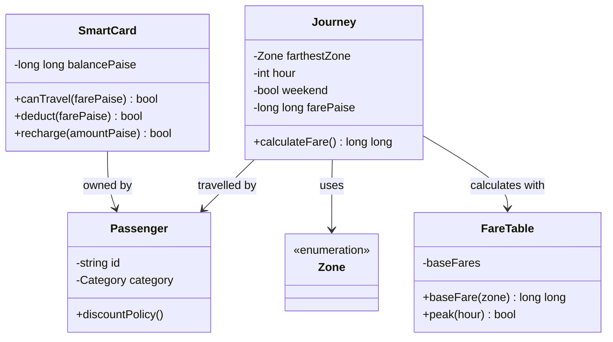

## Task 1 — Objects and rules (4)

A `SmartCard` owns a balance and provides `canTravel`, `deduct`, and `recharge`; hiding the balance prevents unrelated code from making it negative or bypassing the Rs 50 minimum. A `Passenger` holds an identity and category (ordinary, student, senior), which is useful because concessions depend on the rider. A `Journey` records origin/destination or farthest zone, hour, date/weekend flag, and the computed fare; it represents one transaction and its audit trail. `Zone` is a finite set of named network regions. `FareTable` owns the base fares and rule parameters so a fare revision has one source of truth.

Procedurally, global balance/fare arrays and free functions can calculate and debit a journey. In the OO design, state and the operations that protect its invariants live together. Encapsulation is the private card balance; abstraction is exposing `deduct(fare)` instead of requiring callers to manipulate paise. Inheritance may model `StudentPassenger` and `SeniorPassenger` from a common `Passenger`, but a category/strategy is often simpler if only the discount policy varies. Polymorphism can provide a virtual `discountFor(Journey)` strategy, allowing concession rules to vary without branching throughout fare calculation.

Rules: valid zone and hour; fare nonnegative; fare calculated in exact paise; fare uses the farthest zone; peak boundaries are inclusive at 8/17 and exclusive at 10/20; card starts/recharges nonnegative; a debit occurs only if `balance - fare >= 5000`; denial leaves balance unchanged. Per journey, the fare decision and debit are O(1), and state per card is O(1). Procedural and OO forms have the same asymptotic time and per-card storage. OO centralizes invariants and usually localizes a rule change; procedural code can be equally fast but requires disciplined access to shared state and may need edits in multiple call sites.

**Alternative and complexity:** A procedural solution uses `long long balancePaise`, `baseFare(zone)`, `isPeak(hour)`, `computeFare(...)`, and `canTravel(balance,fare)` functions. Complexity remains O(1) per journey and O(1) memory per card in both versions. Changing a minimum-balance rule is one constant change if centralized in either style; if it was duplicated, each duplicate has to be found and changed. Encapsulation reduces the chance of missing a debit path.

Conceptual UML for the OO design:

